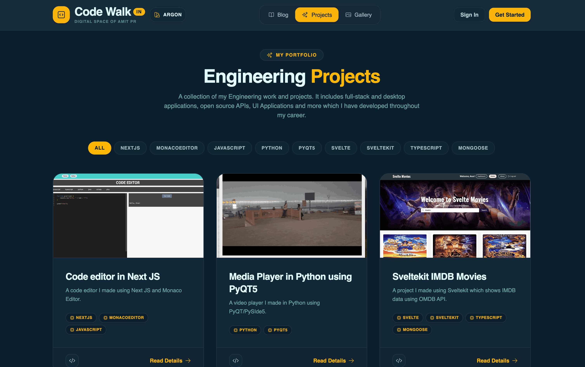
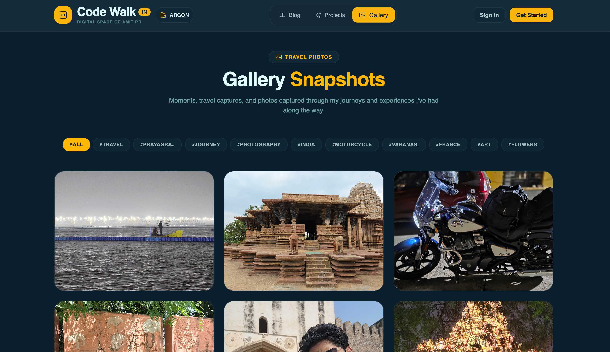
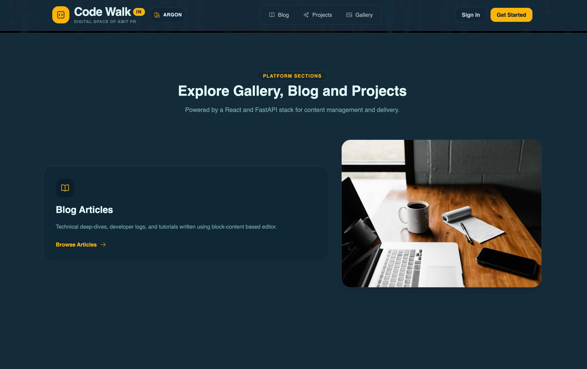

# Codewalk Frontend

## Introduction

**Codewalk Frontend** is the modern, high-performance web interface for [codewalk.in](https://codewalk.in), a personal blogging and developer portfolio platform. Built with **Next.js (App Router)** and **React**, it delivers a seamless user experience across three core content pillars: **Blog Articles**, **Engineering Projects**, and a visual **Gallery**. 

The application interfaces directly with a high-performance FastAPI backend to fetch cached data, manage rich-text content, and handle authentication and interactive state.

---

## Key Features

- **Dynamic Content & Block Editing:** Integrated with **Editor.js** for block-based content creation and rendering (supporting headers, lists, code blocks, checklists, images, and tables).
- **Multi-Section Portfolio:** Dedicated modules for technical blogs, deep-dive project showcases, and a photography/visual gallery.
- **State Management & UI Dynamics:** Powered by **Zustand** for lightweight global state, alongside **Headless UI**, **Lucide React**, and **Heroicons** for accessible, modern primitive components.
- **Animations & Visual Flair:** Smooth scroll-triggered transitions and animations using **AOS (Animate On Scroll)** and **GSAP**.
- **Authentication & Security:** Secure OAuth integration via `@react-oauth/google` and token management with `js-cookie`.
- **Responsive Toast Notifications:** Interactive feedback loops powered by `react-toastify`.

---

## Tech Stack & Architecture

- **Framework:** [Next.js](https://nextjs.org/) (App Router, Server-Side Rendering, Static Generation)
- **UI Library:** [React](https://react.dev/)
- **Styling:** [Tailwind CSS v4](https://tailwindcss.com/) with PostCSS
- **Rich Text Engine:** [Editor.js ecosystem](https://editorjs.io/) (Checklists, Code, Delimiters, Inline Code, Quotes, Tables)
- **State & Utilities:** Zustand, Axios, JS-Cookie
- **Animation & Motion:** GSAP, AOS
- **Testing:** Jest & Jest Environment JSDOM
- **Language:** Javascript

---

## Project Structure

```tree
codewalk-frontend/
├── src/
│   ├── app/             # Next.js App Router pages and layouts
│   ├── components/      # Reusable UI primitives and layout blocks
│   ├── hooks/           # Custom React hooks
│   ├── store/           # Zustand global state stores
│   ├── lib/             # Library functions and API service wrappers
│   └── utils/           # Helper functions and API service wrappers
├── public/              # Static assets, icons, and images
├── postcss.config.mjs   # Postcss configuration
└── package.json         # Project dependencies and scripts

## Project Screenshots

### Project


### Gallery


### Gallery Detail Page


### Homepage

